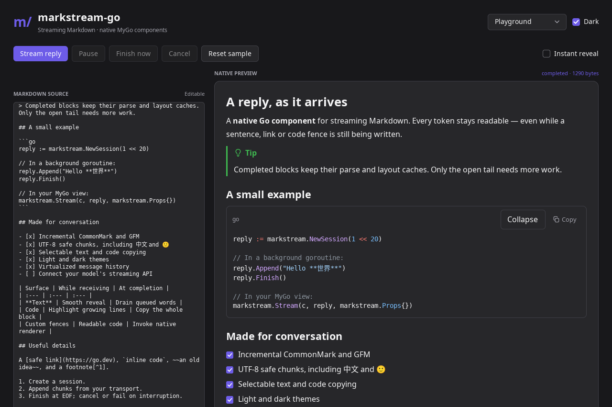

# markstream-go

**Streaming Markdown components for [MyGo](https://github.com/egoist/mygo), written in Go and rendered with native controls.**

[中文说明](README.zh-CN.md) · [API guide](docs/api.md) · [Feature comparison](docs/parity.md) · [Performance](docs/performance.md) · [Demo](examples/demo)



Build an LLM conversation, a streamed document, or a Markdown viewer without a webview. Inspired by [markstream-vue](https://github.com/Simon-He95/markstream-vue)'s streaming workflow and [Lobe MyGo](https://github.com/lobehub/lobe-mygo)'s native component approach. Parsing, text shaping and native drawing use MyGo; this library adds a concurrent streaming model, lifecycle handling, native components and a runnable playground.

## Features

- CommonMark and GFM: headings, emphasis, links, images, nested lists, task lists, tables, quotes, alerts, footnotes, inline code and fenced code.
- Incremental parsing, incomplete-inline healing, cached finished blocks, and strict Markdown finalization at EOF.
- Thread-safe `io.Writer` sessions with UTF-8 chunk buffering, byte limits, immutable snapshots, cancellation, errors and generation-safe resets.
- Coalesced window invalidations, smooth character/word/line reveal and a completion signal that includes queued animation.
- Native highlighted code blocks, language/filename headers, copy, collapse, height limits and wrapping.
- Virtualized variable-height **message lists**, stable row identities, follow-to-end and scroll anchoring.
- Light/dark theming, selectable text, native clipboard formats, anchors, image loaders and custom block/code/math renderers.
- A Go-only desktop demo with an editable source, streaming controls and a 1,000-message history. The same UI is tested using MyGo's native software renderer.

The first version targets the core streaming Markdown workflow. Mermaid/D2/infographic engines and TeX typesetting are **extension points, not bundled renderers**. They fall back to readable source. Single-document block virtualization and Vue's File/FileDiff surfaces are not implemented; see the explicit [comparison](docs/parity.md).

## Install

Requires **Go 1.27.3+** (required by the pinned MyGo version).

```sh
go get github.com/zerob13/markstream-go
```

Native applications need neither Node nor Bun. MyGo supports macOS, Windows and Linux without cgo; Linux desktop execution needs MyGo's platform libraries and a display. Headless component tests and snapshots do not need a display server.

## Quick start

```go
package main

import (
    "log"

    "github.com/egoist/mygo"
    "github.com/egoist/mygo/ui"
    markstream "github.com/zerob13/markstream-go"
)

func main() {
    reply := markstream.NewSession(1 << 20) // 1 MiB; 0 means unlimited
    mygo.App.WhenReady(func() {
        mygo.NewWindow(mygo.WindowOptions{
            Title: "Streaming Markdown",
            Width: 800, Height: 600,
            Content: ui.View(func(c *ui.Context) {
                ui.Scroll(c).Fill().Children(func() {
                    markstream.Stream(c, reply, markstream.Props{})
                })
            }),
        })
        go func() {
            if err := reply.Append("# Hello\n\nNative **streaming** Markdown."); err != nil {
                reply.Fail(err)
                return
            }
            _ = reply.Finish()
        }()
    })
    if err := mygo.App.Run(); err != nil {
        log.Fatal(err)
    }
}
```

`Stream` subscribes to the session and safely requests UI frames. Write from a producer goroutine; build controls on the UI thread. A session is one logical reply; use `Reset` to start another generation. Give repeated controls stable keys with `c.Key(messageID)`.

For a string already in your application state:

```go
markstream.View(c, markdown, markstream.Props{
    Streaming: receiving,
    Variant:   markstream.ChatStyle,
    CodeOptions: &markstream.CodeOptions{
        Collapsible: true,
        MaxHeight:   360,
        Filename:    markstream.FenceFilename,
    },
})
```

Keep the view in the same keyed position when `Streaming` becomes false. Call `markstream.Revealed(element)` **inside the same UI frame**, after building the view, to determine whether all received text has finished appearing. Receiving is not equivalent to animation completion.

## Run the demo

```sh
git clone https://github.com/zerob13/markstream-go.git
cd markstream-go
go run ./examples/demo
```

The playground provides **Stream reply**, **Pause/Resume**, **Finish now**, **Cancel**, an editable Markdown source, instant reveal, a dark theme, code folding and virtualized history.

Without a desktop:

```sh
go run ./examples/demo -smoke
go run ./examples/demo -snapshot artifacts/demo-light.png
go run ./examples/demo -dark -snapshot artifacts/demo-dark.png
```

These execute the native MyGo view and software renderer; they are not browser screenshots or HTML substitutes.

## Develop

```sh
go mod download
go test ./...
go test -race ./...
go vet ./...
go build ./examples/demo
go test -run '^$' -bench . -benchmem
```

See [CONTRIBUTING.md](CONTRIBUTING.md) for the workflow, [docs/api.md](docs/api.md) for transport integration and custom renderers, and [docs/performance.md](docs/performance.md) for measured results and limits.

## License and acknowledgements

[MIT](LICENSE). MyGo supplies the incremental Markdown parser and native UI implementation under MIT. markstream-vue and Lobe MyGo informed the architecture; neither JavaScript/Vue runtime nor Lobe's component implementation is included. See [THIRD_PARTY.md](THIRD_PARTY.md).
