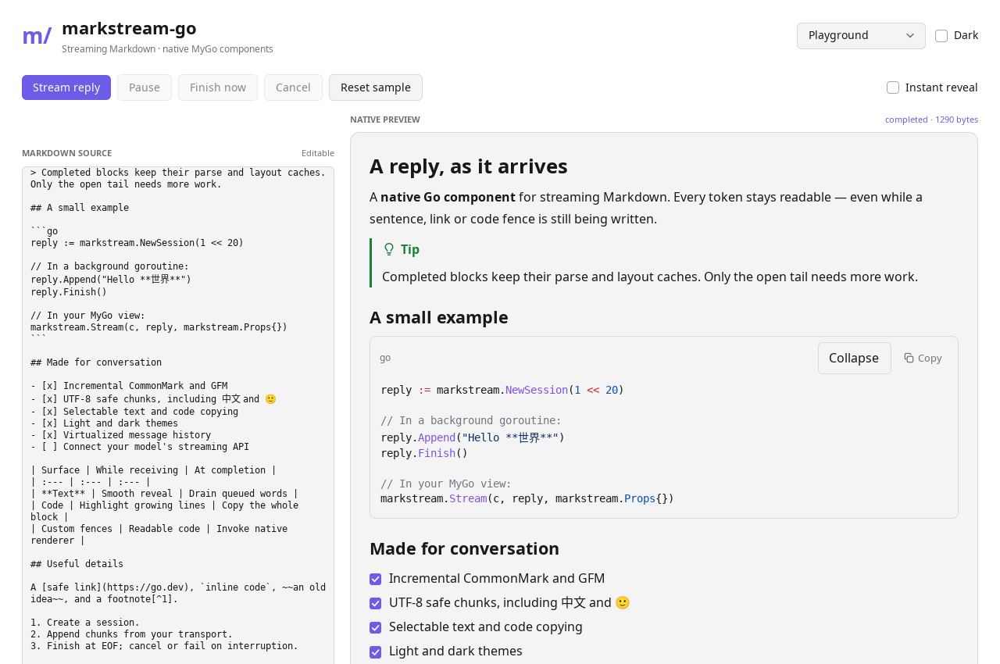

# markstream-go

基于 [MyGo](https://github.com/egoist/mygo) 的 Go 原生流式 Markdown 组件库。适用于 AI 聊天、流式文档和 Markdown 阅读器，不需要 HTML、JavaScript 或 WebView。

[English](README.md) · [API 文档](docs/api.md) · [与 Vue 版的功能对照](docs/parity.md) · [性能验证](docs/performance.md)



## 首版能力

- CommonMark / GFM：标题、强调、删除线、列表、任务列表、表格、引用、提示块、脚注、链接、图片描述和代码块。
- 复用 mygo 原生增量解析器，缓存已完成内容，修复流式尾部未闭合语法，结束后恢复严格 Markdown 语义。
- 线程安全 `Session`：支持 `io.Writer`、UTF-8 跨字节分片、字节上限、不可变快照、完成、取消、错误和重置。
- 合并更新通知，提供逐字、逐词、逐行等平滑呈现方式；收到 EOF 后仍能完成剩余动画。
- 原生代码高亮、语言/文件名、复制、折叠、最大高度和自动换行。
- 按消息虚拟化的聊天列表：只构建可见行及少量预加载行，支持变高消息、稳定 ID、滚动锚定和跟随末尾。
- 明暗主题、文本选择、剪贴板、自定义代码语言/块渲染、图片加载、数学与 HTML 渲染钩子。
- 完整原生 demo：编辑 Markdown、流式播放、暂停/恢复、立即完成、取消，以及 1,000 条消息列表。

**范围说明：**首版对标核心流式 Markdown 工作流，不宣称与 markstream-vue 的全部可选集成等价。Mermaid、D2、Infographic、TeX 排版需要宿主提供原生渲染器；默认显示源码。单篇文档的块级虚拟化和 File/FileDiff 增强界面尚未实现。详细对照见 [docs/parity.md](docs/parity.md)。

## 安装与运行

需要 **Go 1.27.3 或更高版本**，与锁定的 mygo 版本一致。原生应用无需 Node/Bun。

```sh
go get github.com/zerob13/markstream-go

git clone https://github.com/zerob13/markstream-go.git
cd markstream-go
go run ./examples/demo
```

Linux 桌面运行需要 mygo 的系统依赖和可用显示服务；无需显示服务时，可以执行真实原生控件的无窗口测试和截图：

```sh
go run ./examples/demo -smoke
go run ./examples/demo -snapshot artifacts/demo-light.png
go run ./examples/demo -dark -snapshot artifacts/demo-dark.png
```

## 使用方式

在后台 goroutine 中写入：

```go
reply := markstream.NewSession(1 << 20)
if err := reply.Append("你好，**流式 Markdown**"); err != nil {
    reply.Fail(err)
} else {
    _ = reply.Finish()
}
```

在 mygo 的 UI view 中渲染：

```go
ui.Scroll(c).Fill().Children(func() {
    element := markstream.Stream(c, reply, markstream.Props{
        Variant: markstream.ChatStyle,
        CodeOptions: &markstream.CodeOptions{
            Collapsible: true,
            MaxHeight: 360,
            Filename: markstream.FenceFilename,
        },
    })
    // 必须在构建 element 的同一帧内读取。
    ready := reply.Snapshot().Done() && markstream.Revealed(element)
    _ = ready
})
```

`Session` 会自动通知已经挂载的视图。`Finish` 表示输入完成，`Revealed` 表示呈现动画也已完成。取消/失败会保留完整文本；`Reset` 会隔离上一代 `Consume` 生产者，避免旧回复污染新回复。列表中的每条消息需要稳定且唯一的 ID。

已有字符串可以用 `markstream.View(c, source, Props{Streaming: true})`。流结束后，将同一个控件位置的 `Streaming` 设为 `false`，不要切换控件身份。

## 开发验证

```sh
go test ./...
go test -race ./...
go vet ./...
go build ./examples/demo
go test -run '^$' -bench . -benchmem
```

测试覆盖 UTF-8 分片、状态切换、并发和重置、每个字节分割位置的最终解析一致性、未闭合语法、原生复制与链接、代码折叠、虚拟列表及 demo 控制。

项目参考 [markstream-vue](https://github.com/Simon-He95/markstream-vue) 的流式策略和 [lobe-mygo](https://github.com/lobehub/lobe-mygo) 的原生组件组织方式；解析与原生绘制由 mygo 提供。[MIT 协议](LICENSE)。
