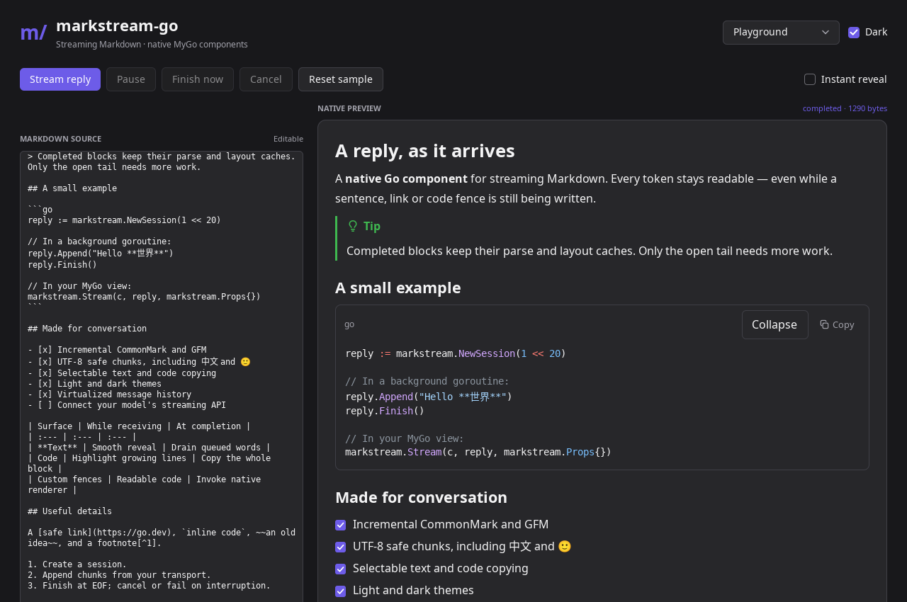

# markstream-go

面向 [MyGo](https://github.com/egoist/mygo) 的 Markdown 流式渲染组件库，使用独立的 Go 节点树和渲染器。

[English](README.md) · [API](docs/api.md) · [功能对照](docs/parity.md) · [性能与验证](docs/performance.md)



以 [markstream-vue](https://github.com/Simon-He95/markstream-vue) 的流式体验和功能为参照，借鉴 [Lobe MyGo](https://github.com/lobehub/lobe-mygo) 的原生组件组织方式，适用于 AI 对话、流式文档和长 Markdown 文件。

**没有直接使用 MyGo 的 Markdown 控件，也没有将它复制到仓库中。** 节点模型、节点渲染、流式尾部处理、逐字显示和淡入、代码块、虚拟文档及扩展注册均由 markstream-go 实现。MyGo 提供底层 CommonMark/GFM 解析器、UI 原语、文本和 Diff 编辑器基础能力。

## 功能

- CommonMark/GFM、嵌套和任务列表、表格、提示块、脚注、定义列表、`:::` 容器和可折叠详情。
- 接收中的不完整语法修复、EOF 严格还原、增量解析、完成节点缓存；编辑和前插保持节点身份。
- 可并发写入的 `io.Writer` Session：UTF-8 分块、容量限制、不可变快照、通知合并、取消和防旧请求污染的重置。
- 按完整字素、词、句、行、段落渐进显示，实际淡入、减少动态效果支持，以及等待异步渲染完成的事件。
- 原生代码高亮、文件名、复制、折叠、换行、字号和自定义头部。
- **File / FileDiff / Compare**：行虚拟化、并排/统一布局、词/字符差异、补丁原始行号、上下文展开、行选区、边栏操作和注释；流式 Diff 与最终编辑器衔接。
- **单篇长文档虚拟化**和消息列表虚拟化，变高测量、锚点、跟随末尾、可序列化的位置与高度缓存。
- **实际内置 Mermaid、KaTeX、D2、AntV Infographic 引擎**，有效前缀渐进预览、保留上次有效结果、源码切换、缩放、拖动、全屏、SVG/PNG 导出。
- 有大小限制的图片加载、SVG、原生图片预览、安全链接、标题和脚注跳转、扩展行内语法、emoji、净化后的 HTML。
- 作用域独立的节点/标签/语言替换、解析后节点输入、解析钩子、主题和中文控件文案。

应用窗口使用原生 MyGo 控件，**没有 WebView**。基础 Markdown、代码和 Diff 仅需 Go。可选 `rich` 包内嵌真实引擎和字体，通过共享的 **headless Chromium 后台进程**计算复杂图形及 HTML 布局；需要本机安装 Chromium/Chrome，运行时不从 CDN 下载资源。只有重建这些已提交资源时才需要 Node。具体架构和原生端差异见[功能对照](docs/parity.md)。

## 安装和接入

需要 Go **1.27.3+**，与固定的 MyGo 依赖一致。

```sh
go get github.com/zerob13/markstream-go@main
# 使用可选的 rich 包时：
go get github.com/zerob13/markstream-go/rich@main
```

```go
import (
    "github.com/egoist/mygo/ui"
    ms "github.com/zerob13/markstream-go"
    "github.com/zerob13/markstream-go/rich"
)

// 应用状态，保留到窗口关闭；退出时 engine.Close()。
reply := ms.NewSession(1 << 20)
engine := rich.New(rich.Options{})

// UI 帧内：
ms.Stream(c, reply, ms.Props{
    Locale: "zh-CN",
    Emoji: true,
    Rich: &ms.RichOptions{Renderer: engine, Progressive: true},
    CodeOptions: &ms.CodeOptions{
        Collapsible: true, ShowFontSize: true,
        MaxHeight: 360, Filename: ms.FenceFilename,
    },
})

// 后台生产者写入 Markdown 文本增量：
_ = reply.Append("# 你好\n\n这是 **流式内容**。")
_ = reply.Finish()
```

完整可运行入口见英文 README 或 `examples/demo`。上面的代码是接入片段，`c` 为 MyGo UI 上下文。

Session 的网络接收完成与视觉完成是两件事：`OnFinal` 在 EOF、显示队列、淡入和当前挂载内容的异步任务结束后触发。`Revealed(element)` 需在构建该元素的同一帧读取。SSE/模型 JSON 应先解码，只把文本 delta 写入 Session。失败用 `Fail`，取消用 `Cancel`。

长文档可传入持久化的 `VirtualState`，调用 `ScrollTo`、`Capture` 和 `Restore`。默认超过 220 个顶层节点自动虚拟化；可用 `MaxLiveNodes` 或 `DisableVirtualization` 调整。源码、宽度和测量配置不兼容时拒绝恢复旧高度缓存。

## 原生 Demo

```sh
git clone https://github.com/zerob13/markstream-go.git
cd markstream-go
go run ./examples/demo
```

五个页面：流式 Playground、富内容画廊、5,000 节点长文档、FileDiff、1,000 条消息历史。支持暂停、继续、取消、立即完成和重置，富内容画廊可以直接转成流式播放。

富内容需要 Chromium/Chrome；可通过 `MARKSTREAM_CHROME_PATH` 指定路径。容器测试无法启用 Chromium sandbox 时可设置 `MARKSTREAM_CHROME_NO_SANDBOX=1`；普通桌面默认保留 sandbox。

无显示服务器也可以运行同一套原生 UI 的交互测试和软件渲染：

```sh
go run ./examples/demo -smoke
go run ./examples/demo -dark -snapshot artifacts/demo-dark.png
go run ./examples/demo -page 'Rich content' -snapshot artifacts/gallery.png
go run ./examples/demo -page 'File diff' -snapshot artifacts/diff.png
go test ./...
go test -race ./...
go vet ./...
```

Linux/macOS/Windows 支持来自 MyGo，基础构建不依赖 cgo。真实桌面运行仍需要系统图形库及显示服务。跨平台构建与无显示测试不等于已经在所有系统人工验收；验证范围见[性能文档](docs/performance.md)。

## 许可证

组件库采用 [MIT](LICENSE)。第三方引擎及字体保留各自许可证，D2 为 MPL-2.0，声明和对应源码地址见 [THIRD_PARTY.md](THIRD_PARTY.md)。
