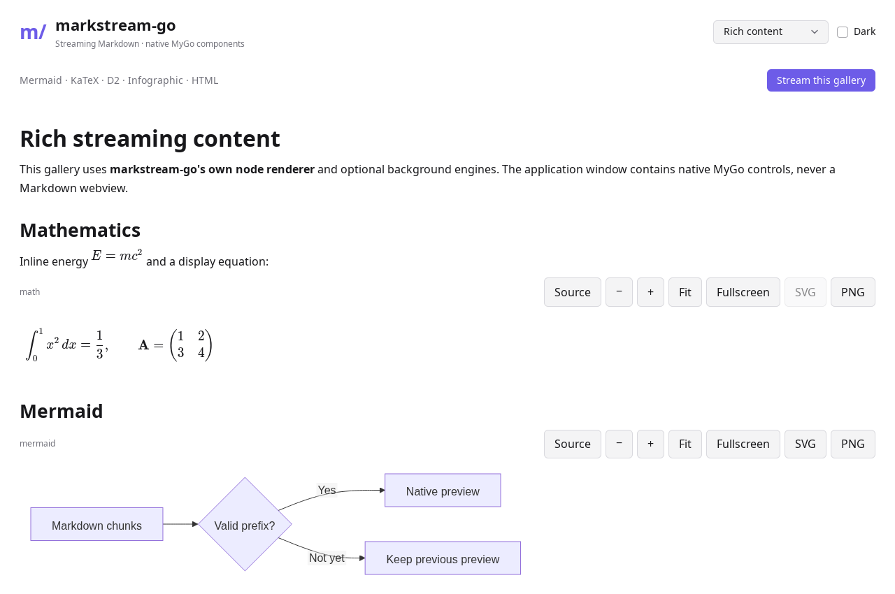
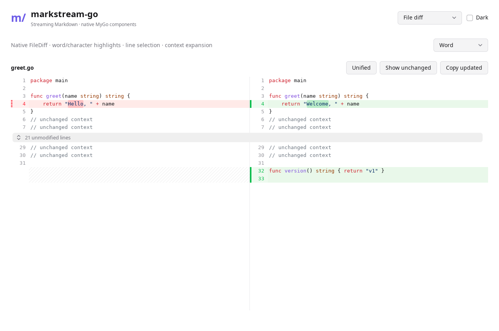

# markstream-vue capability mapping

The native implementation targets the streaming workflow and rendered content of markstream-vue. This is a Go API with native controls, rather than a source-compatible Vue port. The reference checkout used during implementation was `Simon-He95/markstream-vue` on `main` in November 2026.

## Architecture

```text
producer / decoded model deltas
          ↓
Session: UTF-8, limits, immutable source, coalesced wakeups
          ↓
Markstream reveal + incremental CommonMark/GFM syntax dependency
          ↓
Markstream Node tree + streaming projections + stable identities
          ↓
Markstream node registry / native blocks / virtual document
          ↓
MyGo UI text, controls, lists, images and editor primitives
```

`github.com/egoist/mygo/ui/markdown` is neither imported nor copied. Only `github.com/egoist/mygo/ui/markdown/parser` supplies low-level syntax. Markstream owns `nodes.go`, `renderer.go`, `inline.go`, `reveal.go` and `virtual.go`. Markstream's FileDiff adapter uses MyGo's editor primitive, not its Markdown control.

The optional `rich.Engine` runs the same families of real engines used by the Vue ecosystem: Mermaid 11.12.2, KaTeX 0.16.25, D2.js 0.1.33 and AntV Infographic 0.2.3. Assets, lazy diagram chunks, WASM and fonts are embedded and served only on loopback. A shared headless Chromium process performs layout off the UI thread; native components display its raster output, offer controls and export actual SVG where the engine produces SVG. There is no WebView in the application window and no CDN dependency. This backend is not a pure-Go implementation of those graphics engines.





## Mapping

| Capability | Native implementation | Validation |
| --- | --- | --- |
| CommonMark/GFM | Headings, paragraphs, inline formatting, code, nested/ordered/task lists, rules, tables, links, images, quotes | Mixed corpus, every-byte split/final parse comparisons, native controls |
| Extensions | Alerts, footnotes/backlinks, definitions, nested `:::`/details, mark/insert/sub/sup and optional emoji dictionary | `syntax_test.go`, `renderer_cache_test.go` |
| Incomplete syntax | Low-level parser repair, own open-tail projection; unfinished closing-fence prefixes held until disambiguated; strict EOF restores literals | `document_test.go`, `view_test.go` |
| Incremental/stable rendering | Append parsing, immutable own nodes, cached finished inlines, late-reference invalidation, stable IDs across edits and prepends | Cache/identity regressions; benchmark fixtures |
| Source or AST input | `View`, `Stream`, `Parser`, `Props.Nodes`, source/document/node transforms and parse revisions | Parsed input and transform tests |
| Scoped components/custom tags | Per-view `NodeRenderers`, `CustomHTML`, language and block callbacks; HTML/container attributes | Native registry and inline/block tag tests |
| Smooth stream/final state | Grapheme/word/sentence/line/paragraph pacing, opacity fade, reduced motion; settled/final events include mounted asynchronous work | Visual pixel tests, EOF drain and native rich integration |
| CodeBlock | Native tokenizers, stable line gutters, headers/filename/copy, wrap/horizontal scroll, collapse, height limit, font controls and header builders | `code_test.go`, native demo smoke |
| File | Line virtualization, changed-line token cache, tabs/font/palette, click callbacks and native annotations | `diff_test.go`, native interaction tests |
| FileDiff | Unified patches and original/updated files; split/unified, word/character diff, original hunk line offsets, context expansion, line selection, gutter actions and annotations | Patch conversion tests, native editor controls and demo screenshot |
| Streaming diff | Tolerant incomplete patch parsing and lightweight virtual rows; closed/final fence switches to native diff editor | Open/final diff tests |
| Single long document | Block-level native virtual list, shared references/footnotes, variable-height measurements, stable keys and prepend anchoring | 4,000+/5,000-node tests and bounded visible builds |
| Position/height cache | `VirtualState.Capture/Restore`, content/width/layout key validation, source signatures per measurement | JSON round trip, middle restore, width rejection |
| Message history | `Messages`, stable message IDs, follow-end, variable row heights and scroll navigation | 1,000-message native demo test |
| Math | Real KaTeX display/inline layout and baselines; configuration/macros, asynchronous caching, native inline object painting | Real PNG/nonblank output, custom macro and native object pixel tests |
| Mermaid | Real diagrams, valid-prefix rendering, last valid preview, source, zoom/pan/fit/fullscreen, SVG/PNG export | Flow/sequence/class/state/ER/Gantt/pie/Git/mindmap/timeline/XY/sankey/block/journey fixtures; native controls/export tests |
| D2 / Infographic | Bundled real engines, configurations, background layout, progressive preview and the same native graphic controls | Real generated SVG/PNG with labels and nonblank pixels |
| HTML/SVG | Native inline formatting/custom tags; sanitized full HTML/SVG layout through the optional worker | Attribute/tag tests, unsafe HTML execution/link rejection |
| Images | Bounded HTTP(S)/data loading, relative base URL, redirect policy, dimension limits, native SVG/raster and zoomable previews | Local HTTP/data fixtures, limits, policy and native preview test |
| Links/anchors | Guarded host callbacks, safe web/mail/relative links, heading/footnote scrolling | Unsafe URL rejection; global virtual references |
| Selection/clipboard | Native mounted-text selection; text/HTML/Markdown formats; partial Markdown formatting; Copy Markdown menu/shortcut | Partial-source clipboard and native code-copy tests |
| Theme/localization | Window light/dark, independent theme structure, editor palette, English/Chinese control text and custom `Labels` | Native light/dark images and label override test |

## Native-platform differences

- Vue components, DOM events, CSS variables, SSR hydration and browser worker APIs are replaced by Go props, UI builders, native themes and background goroutines/processes. Their JavaScript prop names are not Go compatibility promises.
- CommonMark/GFM comes from the pinned MyGo parser, rather than markdown-it. Extended syntax is projected by Markstream. Custom parser plugins must be expressed through transforms or node input; arbitrary markdown-it plugins cannot run in Go.
- Graphics and full HTML are rendered images inside native views. They expose source, accessible labels, safe extracted links and exports; they are not an editable DOM or a selectable text layer inside the graphic. Ordinary Markdown and code remain native selectable text.
- A virtual list builds visible nodes plus overscan. `OnFinal` covers current mounted asynchronous work; graphics first scrolled into view can start later. A complete document is still parsed for shared references. Arbitrarily long open paragraphs and full AST input are not constant-memory streams.
- Restored total height is an estimate for unmeasured nodes. Snapshots are accepted only when source, width and measurement configuration match. Font/theme/custom component changes should update `MeasurementKey` or `ParseRevision` as appropriate.
- User-defined inline renderers must build `ui.Text`, `ui.Link` or `ui.RichText`, as required by MyGo's inline model; standalone custom tags can build arbitrary native controls. Use `InlineObject` for an embedded graphic.
- Real rich layout requires Chromium/Chrome. Without it, source and an actionable error remain visible. Core Markdown, File and Diff run without it. Export SVG is available for SVG-producing engines; KaTeX/HTML export PNG.

These boundaries are part of the API contract, rather than placeholder implementations of diagram, math, diff or virtualization features.
