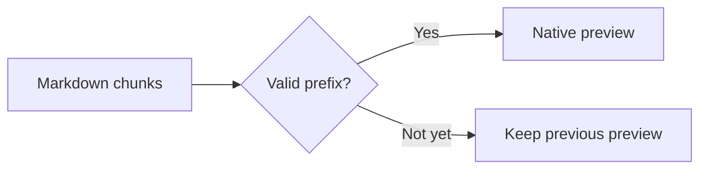

# Rich streaming content

This gallery uses **markstream-go's own node renderer** and optional background engines. The application window contains native MyGo controls, never a Markdown webview.

## Mathematics

Inline energy $E=mc^2$ and a display equation:

$$
\int_0^1 x^2\,dx = \frac{1}{3}, \qquad \mathbf{A}=\begin{pmatrix}1&2\\3&4\end{pmatrix}
$$

## Mermaid



## D2

```d2
direction: right
source: Markdown
parser: Incremental nodes
view: Native MyGo
source -> parser -> view
```

## Infographic

```infographic
infographic list-row-simple-horizontal-arrow
data
  items
    - label Receive
      desc UTF-8 chunks
    - label Parse
      desc Stable nodes
    - label Render
      desc Native controls
```

## Rich HTML and a custom native component

<section><h3>Sanitized HTML</h3><p>Built-in HTML layout, <strong>formatting</strong> and <a href="https://go.dev">links</a>.</p></section>

<status-card>Custom component registered by tag name.</status-card>

## Extended Markdown

==Highlight **nested bold**==, ++inserted text++, H~2~O, x^2^ and :rocket:.

::: tip Stable updates

Completed nodes retain their state as new chunks arrive.

:::

Term
: A definition with **inline formatting**.

A final reference[^note].

[^note]: Native text selection, code copying, previews and exports use the same component model.
